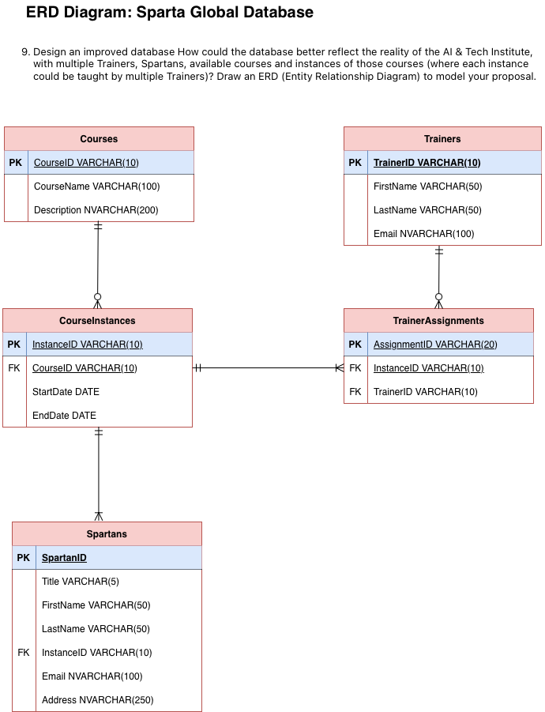

# SQL PRACTICAL EXERCISE

## EXERCISE 1 – CREATE THE SPARTANS AND COURSE TABLES.

### 1.1 Create the tables
`CREATE DATABASE sparta_global;`

`USE sparta_global;`

Write the SQL statements to create the following tables:
- Course table – captures details of courses at Sparta Global: Course ID (e.g. TECH 200), Course Name (e.g. C# Dev), Trainer and Start Date. Add any other columns you think are appropriate.

```
CREATE TABLE Courses (
    CourseID NVARCHAR(10) PRIMARY KEY,
    CourseName VARCHAR(100) NOT NULL,
    Trainer VARCHAR(100) NOT NULL,
    StartDate DATE NOT NULL,
    EndDate DATE NOT NULL
)
```

- Spartans table – holds details of fictional Spartans: their ID, First Name, Middle Name (optional) and Last Name. Add a foreign key column that links each Spartan to the Course table. Add any other columns you think are appropriate.

```
CREATE TABLE Spartans (
    SpartanID INT IDENTITY(1,1) PRIMARY KEY,
    FirstName VARCHAR(50) NOT NULL,
    MiddleName VARCHAR(50) NULL,
    LastName VARCHAR(50) NOT NULL,
    Email VARCHAR(100) NOT NULL UNIQUE,
    CourseID NVARCHAR(10) NOT NULL,

    FOREIGN KEY (CourseID) REFERENCES Courses(CourseID)
);
```

### 1.2 Add data
Write SQL statements to add details of fictional Spartans and Courses to the tables you created.

```
INSERT INTO Courses
    (CourseID, CourseName, Trainer, StartDate, EndDate)
VALUES
    ('TECH 200', 'C# Development', 'David Smith', '2026-10-12', '2026-12-04'),
    ('DATA 201', 'Data Engineering', 'Sarah Jones', '2026-10-19', '2026-12-11'),
    ('TECH 202', 'Java Development', 'Michael Brown', '2026-11-02', '2026-12-18'),
    ('DEV 203', 'DevOps', 'Emily Davis', '2026-11-09', '2027-01-08'),
    ('AI 204', 'Artificial Intelligence', 'James Clarke', '2026-11-16', '2027-01-15');
```

```
INSERT INTO Spartans
    (FirstName, MiddleName, LastName, Email, CourseID)
VALUES
    ('James', NULL, 'Wilson', 'james.wilson@example.com', 'TECH 200'),
    ('Amelia', 'Rose', 'Taylor', 'amelia.taylor@example.com', 'DATA 201'),
    ('Daniel', NULL, 'Johnson', 'daniel.johnson@example.com', 'TECH 202'),
    ('Sophie', 'Grace', 'Williams', 'sophie.williams@example.com', 'DEV 203'),
    ('Adam', NULL, 'Ahmed', 'adam.ahmed@example.com', 'AI 204'),
    ('Olivia', 'Jane', 'Brown', 'olivia.brown@example.com', 'TECH 200'),
    ('Marcus', NULL, 'Green', 'marcus.green@example.com', 'DATA 201'),
    ('Chloe', 'May', 'Evans', 'chloe.evans@example.com', 'DEV 203'),
    ('Ryan', NULL, 'Thomas', 'ryan.thomas@example.com', 'AI 204'),
    ('Aisha', 'Marie', 'Khan', 'aisha.khan@example.com', 'TECH 202');
```

### 1.3 Modify the tables
Your tables are now in use, so dropping and recreating them is not an option. Use ALTER TABLE (and UPDATE where needed) to make each change below. Run a SELECT after each change to confirm it worked.

1. Add a Title column to the Spartans table (e.g. Mr, Ms, Mx, Dr). Then update your existing Spartans so every row has a title.

```
ALTER TABLE Spartans
ADD Title VARCHAR(10) NULL;
```

2. Add a CHECK constraint so Title only accepts values from an agreed list. Test it by inserting a Spartan with an invalid title, and note the error message.

```
ALTER TABLE Spartans
ADD CONSTRAINT CHK_Spartans_Title
CHECK (Title IN ('Mr', 'Ms', 'Mrs', 'Miss', 'Mx', 'Dr'));
```

3. Add an Email column to the Spartans table. Ensure no two Spartans can share the same email address.

This was completed upon creation of the table but the method would be
```
ALTER TABLE Spartans
ADD Email VARCHAR(100) UNIQUE;
```

4. Add an End Date column to the Course table. Add a constraint that prevents a course's end date falling before its start date.

This was completed upon creation of the table but the method would be
```
ALTER TABLE Courses
ADD EndDate DATE
    CONSTRAINT CHK_Course_Dates
    CHECK (EndDate >= StartDate);
```

5. The Course Name column is too short for some course titles. Increase its maximum length without losing any existing data.

```
ALTER TABLE Courses
ALTER COLUMN CourseName VARCHAR(150) NOT NULL;
```
Increasing the size rather than reducing it makes sure the existing course data is preserved.

6. Add a Status column to the Spartans table (e.g. Active, Graduated, Withdrawn) with a default value of Active. Insert a new Spartan without specifying a status, and check the default is applied.

```
ALTER TABLE Spartans
ADD Status VARCHAR(20) DEFAULT 'Active';
```

```
INSERT INTO Spartans
    (FirstName, MiddleName, LastName, Email, CourseID, Title)
VALUES
    ('Emma', NULL, 'Davis', 'emma.davis@example.com', 'TECH 200', 'Ms');
```

```
SELECT * FROM Spartans;
```

7. Make Last Name mandatory. Before applying the change, check whether any existing rows would break the new rule, and fix them first.

To check:
```
SELECT * FROM Spartans
WHERE LastName IS NULL;
```
Result: No Results to Display.
My results were fine but if i did have `NULL` values I could run:

```
UPDATE Spartans
SET LastName = 'Unknown'
WHERE LastName IS NULL;
```
To make last name mandatory:
```
ALTER TABLE Spartans
ALTER COLUMN LastName VARCHAR(50) NOT NULL;
```

8. Rename one column in either table to follow a consistent naming convention, then remove a column you no longer need.

To rename I used `EXEC`:
```
EXEC sp_rename 'Courses.Trainer', 'TrainerName', 'COLUMN';
```
I dropped middle name as its cosiderably the least important data:
```
ALTER TABLE Spartans
DROP COLUMN MiddleName;
```

Extension: Write a short note explaining why changes like these are safer to make with ALTER TABLE than by dropping and recreating a table in a production database.

Using ALTER TABLE is safer because it allows changes to be made to the existing table structure without deleting the table and its data. Dropping and recreating a table could result in data loss and may also remove existing relationships, constraints and indexes. In a production database, ALTER TABLE therefore reduces the risk of losing important data and causing disruption to other parts of the system.

9.  Design an improved database
How could the database better reflect the reality of the AI & Tech Institute, with multiple Trainers, Spartans, available courses and instances of those courses (where each instance could be taught by multiple Trainers)? Draw an ERD (Entity Relationship Diagram) to model your proposal.



## EXERCISE 2 – NORTHWIND QUERIES.

Complete this exercise after working through the SQL Learning Pathway.

1. Customers in Paris or London
Write a query that lists all Customers in either Paris or London. Include Customer ID, Company Name and all address fields.

```
SELECT
    CustomerID,
    CompanyName,
    Address,
    City,
    Region,
    PostalCode,
    Country
FROM Customers
WHERE City IN ('Paris', 'London');
```

2.  Products stored in bottles
List all products stored in bottles.
```
SELECT *
FROM Products
WHERE QuantityPerUnit LIKE '%bottle%';
```

3. Products with supplier details
Repeat 2.2, but add the Supplier Name and Country.

```
SELECT
    Products.ProductName,
    Products.QuantityPerUnit,
    Suppliers.CompanyName AS SupplierName,
    Suppliers.Country
FROM Products
INNER JOIN Suppliers
    ON Products.SupplierID = Suppliers.SupplierID
WHERE Products.QuantityPerUnit LIKE '%bottle%';
```

4. Products per category
Write a SQL statement that shows how many products there are in each category. Include Category Name in the result set and list the highest number first.

```
SELECT
    Categories.CategoryName,
    COUNT(Products.ProductID) AS ProductCount
FROM Categories
INNER JOIN Products
    ON Categories.CategoryID = Products.CategoryID
GROUP BY Categories.CategoryName
ORDER BY ProductCount DESC;
```

5. UK employees
List all UK employees, using concatenation to join their title of courtesy, first name and last name together. Also include their city of residence.
```
SELECT 
(TitleOfCourtesy + ' ' + FirstName + ' ' + LastName) AS FullName,
City, 
Country
FROM Employees
WHERE Country = 'UK';
```
6. High-freight orders to the USA or UK
Count how many Orders have a Freight amount greater than 100.00 and either USA or UK as Ship Country.
```
SELECT
Count(*) AS 'NumOfFreightAbove100',
ShipCountry
FROM Orders
WHERE 
Freight > 100
AND ShipCountry IN ('USA', 'UK')
GROUP BY ShipCountry;
```

7. Highest discount
Write a SQL statement to find the order line with the highest discount applied. Display the order number of the order containing this order line, as well as the discount applied. You can find this information in the [Order Details] table.

```
SELECT TOP 1
OrderID,
Discount
FROM [Order Details]
ORDER BY Discount DESC;
```
 
8. Employee reporting view
Create a view that lists all Employees from the Employees table and who they report to. Query the view.

```
CREATE VIEW employee_reporting_review AS
SELECT e1.FirstName,
e1.LastName,
e2.FirstName + ' ' + e2.Lastname AS ReportingManager
FROM Employees e1
LEFT JOIN Employees e2
ON e1.ReportsTo = e2.EmployeeID;
```
To query the view I used:
`SELECT * FROM employee_reporting_review;`

9. Customer freight stored procedure
Create a stored procedure called CustomerTotalFreightAmount that takes the Customer ID as a parameter and returns the Total Freight Amount for that Customer. Execute the stored procedure where the Customer ID is 'ALFKI'.

Hint: This information is in the Orders table. You can find stored procedures by opening the Northwind database and navigating to Programmability > Stored Procedures.

```
CREATE PROCEDURE CustomerTotalFreightAmount
@customerID VARCHAR(5)
AS
BEGIN
SELECT SUM(Freight) AS 'TotalFreight'
FROM Orders
WHERE @customerID = CustomerID
END; 
```

To execute:
`EXEC CustomerTotalFreightAmount @customerID = 'ALFKI';`

Result:
|TotalFreight|
|--------|
|225.58|


### Further Northwind queries
Write queries to answer each of the following:

1. What are the names and product IDs of the products with a unit price below 5.00?
```
SELECT 
ProductName,
ProductID
FROM Products
WHERE UnitPrice < '5.00';
```

2. Which categories have a category name beginning with B or S?
```
SELECT *
FROM Categories
WHERE CategoryName LIKE 'B%'
OR CategoryName LIKE 'S%';
```

3. How many orders are there for Employee IDs 5 and 7? Give the total for both employees combined.
```
SELECT 
COUNT(OrderID) AS 'TotalOrders'
FROM Orders
WHERE EmployeeID IN (5, 7);
```

4. Employee names and ages
Output a list of Employees from the Employees table, including their Name (concatenated) and their Age (calculated from BirthDate).
Hint: Check your ages carefully. Some date functions count calendar-year boundaries rather than full years, which can make an employee appear a year older if their birthday has not yet occurred this year.

```
SELECT FirstName + ' ' + LastName AS "EmployeeName",
    FLOOR(DATEDIFF(d, BirthDate, GETDATE())/365.25) AS "Age"
FROM Employees
```
5. Use CASE to add a column to the previous activity solution called Retirement Status as follows:

- Age greater than 65 = ”Retired”
- Age greater than 60 = “Retirement due”
- Age less than 60 = “More than 5 years to go”

This was completed using a subquery:
```
SELECT
    EmployeeName,
    Age,
    CASE
        WHEN Age > 65 THEN 'Retired'
        WHEN Age > 60 THEN 'Retirement Due'
        ELSE 'More than 5 years to go'
    END AS retirement_status
FROM(
    SELECT 
        FirstName + ' ' + LastName AS EmployeeName,
        FLOOR(DATEDIFF(d, BirthDate, GETDATE())/365.25) AS Age
    FROM Employees
    ) AS EmployeeAges;
```